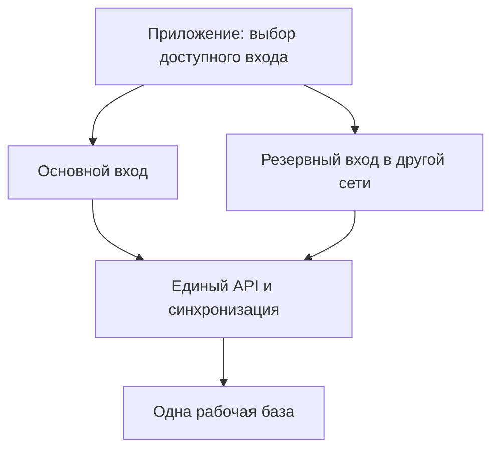

# «Вечер»: полезные публикации и доступность всего приложения

Дата: **23 октября 2026 года, Europe/Moscow**.

Статус: **план утверждён владельцем**, реализация выполняется по этапам.
Владелец подтвердил публикацию 0.6.0 (11); состав этой версии описан в
[CONTENT_RELEASE11.md](CONTENT_RELEASE11.md). После сообщения о частично
недоступных видео и отказе с VPN подготовлен следующий кандидат:
[RUSSIAN_VIDEO_RELEASE12.md](RUSSIAN_VIDEO_RELEASE12.md), RUTUBE и ручная
диагностика подключения, 0.7.0 (12). Его наличие в исходниках не означает
обновления сервера или телефонов. Независимые резервные узлы,
постоянное редакционное пополнение и проверки реальных сетей ещё требуются.

## 1. Уточнённая задача

После установки APK 0.5.0 (10) владелец уточнил:

1. Нужны блоги, авторы и полезная информация по интересам. Нынешние клипы
   не отвечают этому ожиданию. Названия тематических меток нельзя выдавать
   за полноценное наполнение соответствующих интересов.
2. С VPN и без него должен работать весь «Вечер»: вход, данные пары,
   сообщения, файлы, звонки, уведомления, содержание и обновления.

Например, «Лист на поверхности кофе» помечен кулинарией, а «Очень важная
работа лапами» — домом. Это не делает их рецептом или домашней инструкцией.
Фильтрация и перенос этих файлов на свой хост сами по себе не создадут
запрошенный продукт.

Аудит выполнен по исходникам APK 10
`511b51f152a1d9841119e94ee2d1c29d982c00bb` и исправлению
`1e32c403d4f197c9f552a8f2b969980743b73081`. Во втором исправлены отбор по
выбранным темам и состояния плеера; его серверные и клиентские проверки
GitHub Actions завершились успешно. Это не реализация настоящего плана
и не подтверждение доступности сетей пользователя.

Нет оснований утверждать, что весь «Вечер» сейчас заблокирован или что
конкретный отказ вызван санкциями, VPN либо оператором. Ранее владелец
подтвердил работу чата и звонков. Новое требование определяет устойчивость
системы; причины отдельных отказов устанавливаются измерениями.

## 2. Границы продукта

Сохраняются Flutter, FastAPI, PostgreSQL, Centrifugo и WebRTC/coturn,
пять разделов «Сегодня», «Вместе», «Чат», «Я», «Пара», пары рядом и на
расстоянии. Основной продукт, чтение и подписки на авторов бесплатны.
Работа над оплатой и будущим «Вечером 18+» остаётся отложенной.

Личные интересы, сохранения, подписки и реакции остаются личными. Общая
подборка использует только явно общие темы. Чат, письма и скрытые желания
не становятся источником рекомендаций. Существующий контракт хранит день
просмотра, а не время чтения/просмотра, паузы или каждый свайп; этот план
такой сбор не добавляет. Частный профиль участника пары не становится
публичным авторским профилем.

«Блоги» первого этапа — публикации, страницы и серии авторов, на которых
можно подписаться. Открытая регистрация публичных блогеров, комментарии,
публичная переписка и самостоятельная загрузка всеми пользователями —
отдельные продуктовые решения; для выполнения нынешней задачи они не обязательны.

## 3. Содержательная лента

Единица содержания — публикация с понятными автором, темой и результатом:

| Формат | Предлагаемый результат |
|---|---|
| Видео | Автор объясняет, показывает или рассказывает; заголовок, описание, при наличии текстовое сопровождение |
| Авторский пост | Текст, фотографии, история, опыт или обзор; переход к автору и его следующим публикациям |
| Практический материал | Рецепт, инструкция, маршрут, список или разбор, к которому можно вернуться и применить |
| Серия | Связанные материалы одного автора/редакции с понятным порядком и продолжением |

«Ужин за 20 минут», «маршрут выходного дня», «организация рабочего места»,
«полезные цифровые инструменты» — примеры направлений отбора, не измеренный
спрос и не утверждение об интересах владельца. Личные интересы могут включать
технику, ремесло, культуру, хобби и юмор. Каждую публикацию не требуется
превращать в упражнение об отношениях.

Подтемы появляются вместе с настоящим наполнением. Тема с одним формально
подходящим клипом не объявляется полноценной ежедневной подборкой.

### Три режима одной ленты

- **Для меня:** выбранные темы, язык и свои явные реакции. Сначала отбор
  подходящего содержания, затем свежесть, разнообразие авторов и свои отметки.
  Подписка не должна незаметно обходить тематический фильтр этого режима.
- **Подписки:** новые материалы выбранных авторов. Здесь понятно, что автор
  может писать на разные темы; дополнительный фильтр показывается явно.
- **Для нас:** отдельно выбранные общие темы. Личные подписки двух людей
  автоматически не объединяются и партнёру не раскрываются.

Управление: «Полезно», «Сохранить», «Подписаться», «Неинтересно», скрытие
автора, поиск по собственному опубликованному каталогу. «Открыть новое» —
явное расширение выбора. Если подходящий материал закончился, приложение
сообщает об этом, а не незаметно подмешивает посторонние публикации.

### Место в существующей архитектуре

| Раздел | Предложенное изменение |
|---|---|
| Сегодня | Несколько новых подходящих материалов, продолжение серии и существующий совместный вечер |
| Вместе | Подраздел публикаций с тремя режимами рядом с действующими карточками и планами |
| Чат | Явно отправить публикацию с собственной подписью |
| Я | Личные темы, авторы, сохранённое и управление скрытым |
| Пара | Уже отправленные друг другу материалы и согласованные совместные действия |

Старый вход в личные сохранения из «Пары» сохраняется переходом. Можно
сохранить рецепт, предложить маршрут, обсудить материал. Начало совместного
плана требует прежних условий взаимности и согласия; публикация не начинает
его сама. Человек может просто читать выбранного автора.

## 4. Поставка содержания и редакция

Первые источники: собственные проверенные публикации, оригиналы приглашённых
авторов с разрешением на размещение и подходящие открытые лицензии. Наличие
бесплатного файла не делает его полезным для выбранной темы.

Для каждого материала фиксируются автор, происхождение, условия размещения,
язык, подтемы, дата проверки, публичная атрибуция, необходимые источники
фактов и ответственный редактор. Предусматриваются исправление и снятие.
Личный опыт не выдаётся за универсальную рекомендацию. Автоматическая
разметка может помогать редактору, но не заменяет проверку и не создаёт
вымышленных авторов или экспертных подтверждений.

Внешний плеер может дополнять материал, но телефон всё равно зависит от
стороннего сервиса. Например, YouTube IFrame загружает собственный API/плеер
[1], а правила YouTube API отдельно ограничивают скачивание и хранение
видеокопий [2]. API не означает разрешение автоматически перекачать чужую
платформу. Для своей доставки предпочтительны оригиналы от авторов и
разрешённые копии; у Commons проверяется лицензия каждого файла [3].

Directus предусмотрен локальным Compose и дорожной картой, но редакционный
процесс в тестовом продукте ещё не готов. Используем его для публичного
содержания, отдельно от личных данных пары:

**Черновик → проверка → подготовка файлов → публикация → исправление/снятие.**

Directus поддерживает неопубликованные версии [4]; конкретная реализация
сверяется с закреплённой версией проекта. Телефон читает API «Вечера», а API —
проверенный опубликованный снимок. Отказ редакторской панели не выключает
уже опубликованные материалы.

Первый редакционный пилот — реальные материалы по нескольким узким темам,
с определённым источником дальнейшего пополнения. Предлагается двухнедельная
проверка полезности с обновлением содержания; это эксперимент, не прогноз
удержания. Поисковые подсказки помогают отбирать темы, но без измерений не
считаются частотностью запросов или доказанным спросом. Проверяем сохранения,
добровольные оценки, применение и возврат к автору. Продолжительность
просмотра и число клипов не подменяют результат.

## 5. Модель и совместимость содержания

Предлагаемые сущности:

- `Author`: стабильный ID, публичное имя, описание, аватар, проверенные ссылки.
- `ContentItem`: тип `video/post/guide`, ID, заголовок, структурированные
  блоки, автор, темы, язык, даты, серия, revision и редакционный статус.
  Произвольный исполняемый HTML не нужен.
- `ContentAsset`: варианты файла/превью, MIME, размер, SHA-256, разрешение,
  длительность и доверенные адреса доставки.
- Личные подписки, сохранения, скрытие и полезность; отдельно — явно общие
  настройки. Приватные поля сохраняют шифрование и очистку проекта.

Новый `/content` API получает поиск и курсорную выдачу. Снимок каталога и
правила курсора предотвращают пропуски/дубли при пополнении. Старый `/videos`
остаётся совместимым адаптером со стабильными ID, состояниями и старыми
сообщениями. Новый тип ссылки в чате требует проверки старого клиента и
понятного текстового перехода; совместимость не предполагается автоматически.

APK 10 разрешает только прежние Wikimedia-хосты. До перехода сохраняем старые
`media_url`/`thumbnail_url`, собственные варианты добавляем совместимыми полями.
Варианты должны присутствовать и в выдаче, и в детали, и в ответах на реакции.
Сначала готовые файлы, затем API, затем новый APK прежним ключом подписи.

Новые таблицы требуют отдельной добавочной миграции и проверенного
восстановления. Старый API со строгой проверкой прежней схемы не считается
пригодным откатом без отдельной проверки совместимости.

## 6. Текущие сетевые зависимости

| Область | Подтверждённое состояние | Необходимое дополнение |
|---|---|---|
| Вход и основные данные | Один compile-time `API_URL`, авторизованный Dio | Доверенные резервные входы и общий выбор адреса |
| Код входа | SMTP; staging отвечает до завершения фоновой отправки | Проверка фактического получения кода и правил повторов |
| Realtime | Отдельный WSS URL, reconnect и сверка REST | Соответствующий доступному входу WSS адрес |
| Чат | Серверный `client_message_id` предотвращает дубль | Устойчивая локальная очередь и история вместо памяти экрана |
| Личные файлы | Авторизованная полная передача, серверное шифрование | Upload ID и статус результата; докачка — отдельное развитие |
| Звонки | HTTP signaling, STUN/TURN, ICE restart | Независимый relay и испытания смены маршрута |
| Push | FCM и серверная очередь | Отдельная проверка фоновой доставки и подходящих альтернатив |
| APK | Отдельные Dio, абсолютный URL; браузер открывает тот же URL | Общий выбор доставки, зеркала, клиентская проверка размера/хеша |
| Видео и превью | Прямые обращения к Wikimedia | Управляемые варианты и независимые копии |
| Шрифты | GoogleFonts, файлы шрифтов не включены в assets | Включение шрифтов в APK без runtime-загрузки |

Основания: `app/lib/core/api.dart`, `updater.dart`, `realtime_controller.dart`,
`realtime_polling.dart`, `push.dart`, `theme.dart`, `app/lib/features/chat/`,
`app/lib/features/calls/`, `backend/app/routers/auth.py`, `chat.py`,
`app_update.py`, `calls.py`, `backend/app/realtime.py`, `attachments.py`.

## 7. Один «Вечер», несколько доверенных входов

Основной и резервный вход ведут к одному логическому API, одной авторизации,
одной рабочей базе и согласованной синхронизации. Независимость резерва
определяется провайдером, адресами и маршрутом, а не только другим доменом
или страной. Вход в другой стране — вариант для измерения, не гарантия.

Публичные материалы и APK могут иметь независимые проверенные копии, звонки —
отдельные TURN-узлы. Частные вложения не публикуются в общем медиакаталоге.
Две несогласованные записываемые базы ради двух адресов не вводятся.

Резервный вход помогает при недоступности пути к основному адресу, если сам
достигает API. Он **не восстанавливает отказавший API/базу**. Standby,
аварийное восстановление, время восстановления и допустимая потеря данных —
отдельный этап; резервные копии нужны независимо от него.

Если шлюз завершает TLS, этот доверенный узел обрабатывает пользовательские
запросы: нельзя говорить, что личные данные туда вообще не попадают. Нужны
защищённая межузловая связь и минимальные логи. TLS passthrough оценивается
по конкретной топологии.

### Общий сетевой слой

Первый этап — небольшой список реально подготовленных HTTPS origins в APK,
последний работающий адрес и ограниченные проверки самого API. Все резервные
адреса нельзя получать только с единственного недоступного сервера.

Позднее для смены адресов без APK добавляется подписанный список: встроенный
ключ проверки, окружение, версия, срок действия, защита от отката и план
ротации. Повреждённая/устаревшая конфигурация не расширяет доверие. Подписанный
список не обязателен для первой версии с фиксированными доверенными адресами.

Общие правила используют API, получение WSS адреса, signaling, личные файлы
и updater. Медиа имеет отдельный публичный транспорт без пользовательского
токена. Нужны общий бюджет ожидания, пауза между повторами и сохранение
работающего адреса, чтобы не переключать все запросы хаотично.

Приложение использует системный маршрут, включая выбранный VPN; не выводит
свои запросы незаметно в обход него. После смены сети пересоздаёт нужные
соединения, сверяет данные и возобновляет безопасные операции. Android
позволяет наблюдать смену сети, но даже `VALIDATED` не доказывает доступность
конкретного сервера [5].

Bearer отправляется только доверенным API origins, не произвольным адресам
или междоменным redirect. `401`, `403`, `409` и `429` не означают сетевой
failover. `POST` не повторяется без идемпотентности или сверки результата;
это особенно важно для запроса/проверки OTP. TLS-проверка остаётся включённой,
публичные URL не строятся из произвольных forwarded headers.

## 8. Действия при разрывах и сохранённые данные

Для чата сохраняем перед отправкой стабильный ID и неизменяемое содержимое
в защищённой локальной очереди. После потерянного ответа сверяемся с сервером
и повторяем тот же ID, развивая существующую дедупликацию. Доставку на сервер
и прочтение партнёром показываем раздельно.

Очередь привязана к аккаунту и конкретной паре. При выходе, смене аккаунта,
разрыве пары и отмене отправления данные не переходят другому человеку.
После восстановления сначала проверяется действующая пара: старые действия
не отправляются новому партнёру. PIN, шифрование, срок хранения и очистка
распространяются и на локальный кэш.

Для вложений нужен стабильный upload ID и запрос статуса после неясного
результата. Сейчас повтор полной загрузки может создать второй blob и занять
квоту. Докачка отдельными частями пока не реализована. Файл очереди должен
храниться в контролируемом app storage, а не только по временному пути picker.

Сохранённые статьи, уже загруженная история и планы доступны из защищённого
кэша с отметкой актуальности. Первичный вход, новый звонок и доставка партнёру
требуют сети. Согласия, разрыв пары, удаление аккаунта и конфликтующие совместные
изменения не помещаются бездумно в общую очередь. Flutter описывает сочетание
локального/удалённого источника в repository [6]; правила зависят от функции.

Centrifugo сохраняет роль уведомления об изменении, REST — источника данных.
Имеющийся foreground polling помогает при недоступном WSS. История брокера
ограничена окном [7] и не заменяет сверку после reconnect. Опрос открытого
приложения не считается доставкой уведомления в закрытое.

## 9. Звонки, push, обновления и публичные файлы

### Звонки

Сигналинг использует доступный API, медиапуть — ICE/STUN/TURN. Нужны
независимые relay-узлы, проверенные UDP/TCP/TLS варианты, актуальная
конфигурация/credentials и ICE restart при потере пути. WebRTC предусматривает
TURN через TCP/TLS для сетей с ограничениями UDP [8].

TURN/TLS на TCP443 может расширить набор работающих сетей, но это не HTTPS
и не гарантия пропуска любым VPN/прокси. На существующем IP443 нужен HTTPS;
обычный HTTP reverse proxy Caddy не превращается в TURN proxy. Для простого
решения требуется отдельный публичный IP/узел либо отдельный проект
транспортной маршрутизации. Действующие сайты не меняются ради проверки.

Смена сети показывает «Восстанавливаем связь»; измеряется реальный перерыв,
а не обещается нулевая задержка. Проверяется relay с двух устройств,
а не только TLS handshake либо прямой успешный звонок.

### Фоновые уведомления

Серверная очередь повторяет отправку FCM, но FCM→телефон — отдельный путь.
Google документирует влияние VPN на долгие push-соединения и ограничения
обычного проксирования доставки [9]. Резервный API не исправляет этот канал.

Проверяются открытое приложение, фон, выгрузка процесса и принудительная
остановка — это разные условия. Дополнительный push-провайдер выбирается
по реальным моделям, ОС и способу установки через общий интерфейс провайдеров.
Универсальность заранее не обещается. Нужны общий event ID, дедупликация,
TTL звонка и удаление регистраций при выходе. Просроченный вызов не звонит заново.

### Обновления

Контракт версии получает доверенные зеркала, размер и SHA-256; клиент проверяет
скачанный файл до установки. Это новая работа: нынешний updater не проверяет
хеш, даже если публикационный пакет проверял файл на сервере. Зеркала содержат
идентичный APK; сохраняются Android signing key, package ID и новый build number.
Доверие к метаданным и проверка Android-подписи остаются обязательными:
сам по себе хеш по соседней ссылке не устанавливает происхождение файла.

Старые APK должны получить совместимое обновление до того, как прежняя точка
доставки окажется единственным препятствием для исправления.

### Содержание и ресурсы интерфейса

Разрешённые оригиналы готовятся заранее: проверенные MP4/H.264/AAC при наличии
аудио, основной и облегчённый варианты, правильные пропорции без искусственного
увеличения малых исходников. Формат проверяется на целевых телефонах;
перекодирование не обещает исправить любой сетевой отказ.

Неизменяемые адреса по хешу, MIME, размер, декодирование и HTTP Range/206
проверяются до публикации каталога [10]. Статику обслуживает файловый сервер
или хранилище; Python не скачивает внешний ролик при каждом просмотре.
Резерв — проверенная независимая копия, не другое имя того же файла.

API bearer не передаётся плееру/CDN. Приватные вложения остаются за
авторизованным API. Шрифты и необходимые интерфейсные ресурсы включаются в APK.

## 10. Очерёдность работы

Две линии идут согласованно: редакционное содержание и доступность системы.
Новый APK не выпускается только ради замены случайных клипов другими.

1. **Пилот и диагностика.** Реальные полезные публикации, источник продолжения
   и воспроизводимые сетевые измерения без сообщений, токенов, SDP и секретов.
2. **База подключения.** Общий выбор доверенных входов, согласованные API/WSS/
   updater, встроенные шрифты. Проверенный резерв в тестовом окружении к одному backend.
3. **Публикации.** Авторы, текст/фото/видео, личные подписки, поиск, курсор,
   сохранение, редакционная публикация без APK и собственная медиадоставка.
4. **Разрывы действий.** Устойчивая очередь сообщений, чтение кэша,
   идемпотентные загрузки и сверка неоднозначных результатов.
5. **Связь и фон.** Независимый TURN, TCP/TLS варианты, восстановление звонка,
   отдельно проверенная доставка push на реальные устройства.
6. **Приёмка и выпуск.** Совместимая миграция с бэкапом и репетицией
   восстановления, новый APK прежним ключом через существующий тестовый
   канал автообновления. Дальше — пополнение по обратной связи.

Это последовательность, не обещанные даты. Трафик, серверы и редакционная
работа требуют ресурсов при бесплатном доступе пользователей. Документ
не выбирает и не покупает сервисы: сначала реальные маршруты, нагрузка и бюджет.

## 11. Приёмка результата

Базовые режимы: один Wi-Fi без/с VPN и одна мобильная сеть без/с VPN.
Дополнительно партнёры используют разные режимы, VPN включается/выключается
во время действия, сеть меняется Wi-Fi↔мобильная. Фиксируются устройство,
ОС, версия приложения, тип сети, время и безопасный код ошибки.

| Сценарий | Критерий |
|---|---|
| Холодный запуск/вход | Экран доступен; сессия сохраняется; новый код действительно приходит и принимается |
| Чат при потере ответа | Одно сообщение после восстановления; очередь переживает закрытие приложения |
| Смена аккаунта/пары | Прежние кэш и очередь не отправляются и не раскрываются другому человеку |
| Файл | Доступен адресату; повтор не создаёт лишние вложения и расход квоты |
| WSS недоступен, HTTPS работает | Открытое приложение сверяет состояние через REST |
| Звонок | Двусторонние звук/видео, forced relay, отдельные TCP/TLS испытания и измеренное восстановление |
| Push | Результаты foreground/background/выгрузки/принудительной остановки разделены |
| Публикация | Один материал проверен на холодной загрузке и из кэша; текст читается независимо от плеера |
| Отказ основного входа | Резерв работает без новой регистрации и дублей действий |
| Отказ самого API/БД | Честный ограниченный режим; резерв входа не объявляется восстановлением сервера |
| Обновление | Версия и APK доступны, размер/хеш проверены, установка поверх прежнего приложения |
| Редакция | Новый полезный материал и исправление выходят без APK; снятое не рекомендуется |
| Интерес | Человек находит нужное, сохраняет/применяет и возвращается к автору |

После испытаний: «проверено на перечисленных устройствах, сетях и режимах».
Не обещаем работу через любой неисправный VPN, без интернета или при
недоступности всех точек. Показываем конкретное состояние и сохранённые данные
вместо бесконечной загрузки.

## Источники

Аудит исходников показывает архитектуру, а не пользовательскую сеть.
Источники подтверждают свойства технологий; решения выше — проект для
«Вечера», не готовая реализация.

1. [YouTube IFrame Player API](https://developers.google.com/youtube/iframe_api_reference).
2. [YouTube API Developer Policies, III.E](https://developers.google.com/youtube/terms/developer-policies).
3. [Wikimedia Commons: reusing content](https://commons.wikimedia.org/wiki/Commons:Reusing_content_outside_Wikimedia).
4. [Directus: content versioning](https://directus.com/docs/guides/content/content-versioning).
5. [Android: read network state](https://developer.android.com/develop/connectivity/network-ops/reading-network-state).
6. [Flutter: offline-first support](https://docs.flutter.dev/app-architecture/design-patterns/offline-first).
7. [Centrifugo: stream history and recovery](https://centrifugal.dev/docs/server/history_and_recovery).
8. [RFC 8835: WebRTC transports](https://www.rfc-editor.org/rfc/rfc8835.html).
9. [FCM: network configuration and VPN](https://firebase.google.com/docs/cloud-messaging/network-configuration).
10. [RFC 9110: HTTP Semantics](https://www.rfc-editor.org/rfc/rfc9110.html).

Связанные документы: [PRODUCT_RULES.md](PRODUCT_RULES.md),
[ROADMAP.md](ROADMAP.md), [SHORT_VIDEOS_CONTRACT.md](SHORT_VIDEOS_CONTRACT.md),
[VIDEO_RELIABILITY_PLAN.md](VIDEO_RELIABILITY_PLAN.md).
